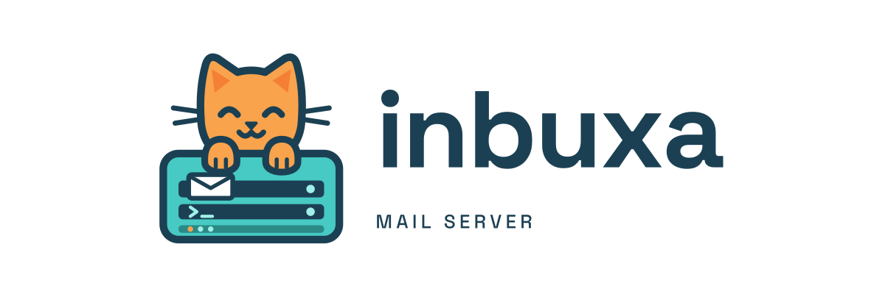

  

<h3 align="center">
  The test lab for inbuxa on Kubernetes
</h3>

  
  
  
  

---

> [!NOTE]
> Development happens on [git.coffeylabs.org/inbuxa/inbuxa-k8s-lab](https://git.coffeylabs.org/inbuxa/inbuxa-k8s-lab); the copy on GitHub is a read-only mirror, and where the end-to-end runs happen.
> Report issues at **[git.coffeylabs.org/inbuxa/inbuxa-k8s-lab/issues](https://git.coffeylabs.org/inbuxa/inbuxa-k8s-lab/issues)**, join discussions at **[community.coffeylabs.org](https://community.coffeylabs.org)**, or chat on **[Discord](https://discord.gg/nqcY4TKfAn)**.

Where [the inbuxa Helm chart](https://git.coffeylabs.org/inbuxa/inbuxa-charts)
is tested on real clusters: end to end, upgrades, failures and load. It's
for developing the chart, not for running mail; the chart's repository says
how to install it.

`lab/e2e.sh` is the whole lab from nothing: the cluster, the chart with the
images the next chart release names (inbuxa-charts `release/suite.yaml`),
seeded, then mail, the webmail and the console, timing each part. It wants
inbuxa-charts checked out next to this repository (or `CHART_REPO=`), and
kind, kubectl and Helm, which `lab/tools.sh` installs at pinned versions,
each checked against its published checksum. CI runs it on GitHub's amd64
and arm64 runners on each Kubernetes minor in `lab/kubernetes.json`, nightly
and on every push (`.github/workflows/e2e.yml`), and each chart branch in
inbuxa-charts calls the same workflow for its own commit.

`lab/chart/mailcheck.sh` is every client check against an installed chart,
in one command: SMTP in, submission, IMAP, JMAP, SMTP out to an outside
server (an SMTP sink in the cluster, `lab/chart/mail-sink.yaml`), CalDAV,
CardDAV, the webmail signing in across both replicas and the console. It's
what `e2e.sh` runs after the install, and what to run after changing the
lab by hand.

`lab/chart/chaos-test.sh` breaks things with mail flowing, a message a
second, and checks that every message the server accepted arrived exactly
once: a server pod killed, a node drained, the PostgreSQL primary failed
over, NATS restarted, S3 frozen for 60 s. CI runs it nightly on the newest
Kubernetes minor, both architectures (`CHAOS=1 lab/e2e.sh`).

`INSTALL_WITH=argocd lab/e2e.sh` (or `flux`) installs the chart through
Argo CD or Flux instead of Helm, from a Helm repository in the cluster
(`lab/gitops/gitops.sh`), then checks what GitOps can get wrong
(`lab/gitops/gitops-test.sh`). Nothing is applied again unchanged and no
Secret changes across refreshes. The controller puts a hand edit back. An
upgrade with every image pinned by digest rolls everything without signing
out webmail tabs left open across it or failing one of their requests. Then the 27.1 crossing from a 2026.x
store, as changes to the controller's spec: refused, then acknowledged.
Under Argo CD the chart's generated secrets are off and the Secrets are
made first; Flux runs Helm, so the chart keeps its own. CI runs both
nightly, on the newest minor and both architectures.

`lab/chart/webmail-restart-test.sh` restarts the webmail under open tabs
and checks no request failed and every live-update stream came back.
`RESTART=` names other Deployments to restart under them instead, such as
the server's groups or the console.

`lab/soak/soak.sh start` is the soak: a week (`SOAK_DAYS`) of steady load
on an installed chart, with a different chaos scenario each day. Mail in
every 10 s and out to the sink every minute, two IMAP clients in IDLE (all
from this host, through the load balancer), and three webmail tabs in a pod.
Each day ends with a report (`day-N.md` in `~/.cache/inbuxa-lab/soak`):
mail sent, arrived, late, lost or doubled, IDLE notices and drops, webmail
failures, and every pod restart or replacement, planned (during chaos) or
not. `report.md` sums up the run. It passes with no message lost or
doubled, no unplanned restart, and every chaos scenario recovered. It runs as a systemd user unit, so
`soak.sh status` and `stop` work from any shell, and `start` resumes a
stopped run. `SOAK_DAY=1800 SOAK_DAYS=2 CHAOS_AFTER=300` tries it in an
hour.

`lab/report.sh` is for release-candidate testers on their own cluster: the
Kubernetes version and distribution, the nodes' OS, kernel, runtime and
architecture, the network plugin and load balancer, the Pod Security level
and anything it refused, the chart and image versions, each component's
pods, and any test results (`--results FILE`), as a block to paste into a
report. It only reads. Names, registries, addresses and hostnames are left
out, and the block is scrubbed of anything shaped like an IP address or a
hostname, unless `--include-names`.

`lab/up.sh` is just the cluster: kind, Kyverno and the policies, MetalLB,
and the data layer (CloudNativePG, NATS, Garage). It adds the Helm
repositories it needs; the versions are pinned in `lab/versions.env`.
`lab/down.sh` removes it all.

The `inbuxa` namespace enforces Pod Security "restricted" and the policies in
`lab/policy/defaults.yaml`: a read-only root, no service-account token (except
the upgrade Job's), secrets never in the environment, and a deny-all
NetworkPolicy over every pod. `lab/policy/policy-test.sh` checks that the
chart passes them and that a bad value is refused.

## License

Free software under the [Apache License 2.0](LICENSE), and a Coffey Labs
project.
